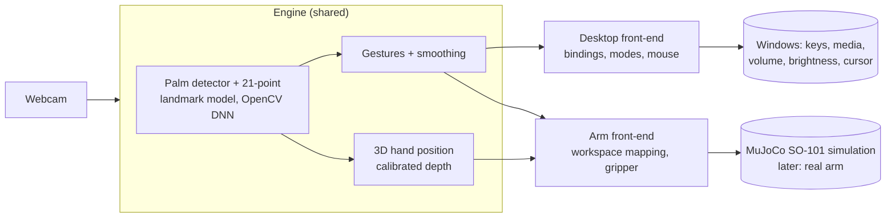

# Hand Tracker (C++)

Real-time hand tracking from an ordinary webcam, with two front-ends built on
the same engine:

| 🖥️ **Desktop** | 🦾 **Robot arm** |
|---|---|
| Control your computer with gestures: skip Spotify tracks with a swipe, switch windows by flipping your hand, dial the volume by tilting your palm, set brightness by raising your hand, or drive the mouse and click with a pinch. | A simulated **SO-101** robot arm (MuJoCo physics) follows your hand anywhere in 3D, and its gripper closes when you make a fist. |
| `handtracker desktop` | `handtracker arm` |

This is **v2**, a ground-up C++17 rewrite of the original Python prototype
([Jzhen7/Hand-Tracker](https://github.com/Jzhen7/Hand-Tracker)). It keeps every
v1 feature, fixes most of v1's reliability problems, and is structured so that
new front-ends, gestures and platforms can be added without touching the engine.

[](https://github.com/Jzhen7/Hand-Tracker-CPP/actions/workflows/ci.yml)

**New to the codebase or to C++?** Start with
[Dash 1: the C++ rewrite](docs/DASH-1_CPP_REVAMP.md) and
[Dash 2: the robot arm](docs/DASH-2_ROBOT_ARM.md). They explain every
decision, tool and design choice.

---

## Architecture at a glance



The engine never depends on a front-end, and the front-ends never depend on
each other.

## Highlights

**Engine**
- **One native binary.** Runs MediaPipe's palm-detection and hand-landmark
  networks through OpenCV's DNN module. No Python, no MediaPipe build, no Bazel.
- **Rotation-, scale- and handedness-invariant gestures.** v1 only recognised
  an upright right hand.
- **MediaPipe-style tracking.** Once a hand is found, the palm detector is
  skipped and the previous landmarks seed the next frame.
- **3D hand position** with depth estimated from apparent palm size, calibrated
  per user.

**Desktop front-end**
- **Time-based motion detection.** Swipes, flips and holds are measured in
  milliseconds, with a cooldown and latched holds.
- **Remappable gestures** in [`config/handtracker.ini`](config/handtracker.ini):
  key chords, media keys, launching apps/URLs, modes, and process-gated bindings
  (e.g. only while `spotify.exe` runs).
- **Non-blocking OS calls** on a worker thread (v1 froze on every brightness change).

**Robot-arm front-end**
- **MuJoCo physics** with the open-source **SO-101** arm model from MuJoCo Menagerie.
- **Inverse kinematics** (damped least squares with a null-space bias) reaches
  any point in a 14 × 26 × 18 cm workspace to within 1 cm (tested).
- **Smooth and safe:** One Euro filtering, a speed limit, workspace clamping,
  and the arm holds position when your hand leaves the frame.
- **Backend interface**, so a real arm can replace the simulator without
  touching the control logic.

**Both:** unit tests plus headless simulation tests, run on Windows, Linux and
macOS in CI.

## Quick start (Windows)

```powershell
# 1. Prerequisites: Visual Studio 2022 (C++ workload), CMake >= 3.16, OpenCV >= 4.7
#    e.g.  winget install Kitware.CMake   and   choco install opencv
# 2. Fetch the hand models (~8 MB), and for the arm: MuJoCo + SO-101 model (~40 MB)
powershell -ExecutionPolicy Bypass -File scripts\download_models.ps1
powershell -ExecutionPolicy Bypass -File scripts\download_arm.ps1     # optional
# 3. Build (the arm is included automatically if step 2's arm download ran)
cmake -S . -B build -DOpenCV_DIR=C:/tools/opencv/build
cmake --build build --config Release
# 4. Run (the build copies OpenCV's and MuJoCo's DLLs next to the exe; CMake 3.21+)
build\Release\handtracker.exe desktop --dry-run
build\Release\handtracker.exe arm
```

Linux/macOS and other build options are covered in [docs/BUILDING.md](docs/BUILDING.md).

```text
handtracker [command] [options]

desktop front-end:
  desktop       gestures trigger actions (default; 'control' also works)
  mouse         move the cursor with your hand, pinch to click
  orientation   visualise the 3D rotation of your hand

robot-arm front-end:
  arm           a simulated SO-101 arm follows your hand; a fist closes the gripper

  -c, --config <file>    config file (default: config/handtracker.ini, or config/arm.ini)
      --camera <index>   camera index
      --models <dir>     directory containing the .onnx models
      --dry-run          log desktop actions instead of performing them
      --no-preview       run without the preview window
      --image <file>     run detection on a still image and exit
```

## Desktop: default gestures

Finger counts start at the thumb: **one** = thumb, **two** = thumb + index,
**three** = thumb + index + middle, **four** = all but the pinky.

| Gesture | Motion | Action |
|---|---|---|
| ✊ fist | hold 1 s | enter **brightness** mode: make a ✌️ peace sign and raise/lower your hand |
| two | hold 1 s | enter **volume** mode: show three and tilt your hand left/right like a dial |
| four | hold 1 s | enter **depth** mode: shows hand distance (experimental) |
| 🖐 palm | any time in a mode | leave the mode |
| one (thumb) | swipe left | previous track *(only while Spotify runs)* |
| three | swipe right | next track *(only while Spotify runs)* |
| four | swipe right | new tab, `Ctrl+T` *(only while Chrome runs)* |
| three | flip hand over | switch window, `Alt+Tab` |
| 🖕 middle | hold 1 s | quit |

Start with `--dry-run` to watch which gestures are recognised before giving the
app control of your keyboard. See [docs/GESTURES.md](docs/GESTURES.md) for the
exact definitions.

## Robot arm: how to use it

1. Run `handtracker arm`. The camera shows on the left and the arm on the right.
2. **Calibrate:** hold an open palm still for 2 s, where it feels comfortable.
   That spot becomes the centre of the arm's workspace.
3. Move your hand: left/right, up/down and toward/away from the camera move the
   gripper the same way.
4. Make a **fist** to close the gripper; open your hand to release.
5. Keys: `c` recalibrate · `a`/`d` rotate the view · `q` quit.

Settings (workspace size, sensitivity, speed limit, gripper angles) are in
[`config/arm.ini`](config/arm.ini). How it all works is in
[Dash 2](docs/DASH-2_ROBOT_ARM.md).

## Project layout

```text
include/handtracker/       (headers)   src/   (implementations)
  core/       engine logic: landmarks, gestures, events, 3D hand position,
              config, filters (no third-party deps)
  vision/     OpenCV DNN palm detector, landmark model, tracker
  ui/         on-frame overlay (skeleton, level bars, toasts)
  arm/        arm front-end: ArmBackend interface, workspace, controller,
              MuJoCo simulated arm with inverse kinematics
src/platform/ Windows backend (Core Audio, WMI, DDC/CI, SendInput) + null backend
apps/         the handtracker executable: desktop, mouse, orientation, arm
tests/        unit tests, synthetic hand generator, headless simulation tests
config/       handtracker.ini (desktop), arm.ini (robot arm)
scripts/      download scripts for models and the arm simulator
docs/         Dash 1 & 2 write-ups, architecture, gestures, config, building, roadmap
```

## What changed from v1

| | v1 (Python) | v2 (C++) |
|---|---|---|
| Runtime | Python + MediaPipe + 10 pip packages | Single executable + OpenCV (+ MuJoCo for the arm) |
| Finger test | `tip.y < knuckle.y` (upright hands only) | distance ratios relative to the wrist (any rotation) |
| Thumb test | `x` comparison, flips with handedness | distance to the pinky knuckle (either hand) |
| Timing | frame counts ("~0.3 s at 20 fps") | milliseconds, plus cooldown and latched holds |
| Hold | same label for 20 frames, even while moving | same gesture *and* hand kept still |
| Bindings | hard-coded `if/elif` chain | INI file, process-gated |
| OS calls | inline, blocking (brightness froze video) | worker thread, coalesced |
| Modes | could only be left with an open palm | also time out when the hand disappears |
| Mouse | raw position, hard-coded offsets, palm = drag | One Euro filtered, edge-clamped, pinch-to-click |
| UI | three tkinter windows | overlay drawn on the preview |
| 3D / robotics | orientation readout only | calibrated 3D hand position driving a simulated arm |
| Tests | none | unit + simulation tests, CI on 3 OSes, model smoke test |

## Documentation

**Explanations (what was built and why)**
- [Dash 1: the C++ rewrite](docs/DASH-1_CPP_REVAMP.md): decisions, tools, C++ primer
- [Dash 2: the robot arm](docs/DASH-2_ROBOT_ARM.md): data flow, simulator, inverse kinematics

**Reference**
- [Building](docs/BUILDING.md) · [Gestures](docs/GESTURES.md) · [Configuration](docs/CONFIGURATION.md) · [Architecture](docs/ARCHITECTURE.md)

**Planning**
- [Future features](docs/FUTURE_FEATURES.md) · [Limitations and roadmap](docs/LIMITATIONS_AND_ROADMAP.md)
- [Contributing](CONTRIBUTING.md) · [Changelog](CHANGELOG.md)

## License

[MIT](LICENSE). Third-party assets are downloaded separately and not part of
this repository:
- the hand models: Google's MediaPipe models as converted by the
  [OpenCV Model Zoo](https://github.com/opencv/opencv_zoo) (Apache 2.0)
- [MuJoCo](https://github.com/google-deepmind/mujoco) (Apache 2.0)
- the SO-101 model from [MuJoCo Menagerie](https://github.com/google-deepmind/mujoco_menagerie) (Apache 2.0)
