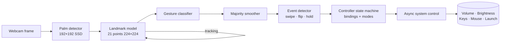

# Hand Tracker (C++)

Control your computer with hand gestures from an ordinary webcam: skip Spotify
tracks with a swipe, switch windows by flipping your hand, dial the volume by
tilting your palm, set screen brightness by raising your hand, or drive the
mouse cursor and click with a pinch.

This is **v2**, a ground-up C++17 rewrite of the original Python prototype
([Jzhen7/Hand-Tracker](https://github.com/Jzhen7/Hand-Tracker)). It keeps every
v1 feature, fixes most of v1's reliability problems, and is structured so that
new gestures, actions and platforms can be added without touching the core loop.

[](https://github.com/Jzhen7/Hand-Tracker-CPP/actions/workflows/ci.yml)

---

## Highlights

- **One native binary, one dependency.** Runs MediaPipe's palm-detection and
  hand-landmark networks through OpenCV's DNN module. No Python, no MediaPipe
  build, no Bazel.
- **Rotation-, scale- and handedness-invariant gestures.** v1 only recognised
  an upright right hand. v2 measures fingers relative to the hand itself.
- **Time-based motion detection.** Swipes, flips and holds are measured in
  milliseconds rather than frames, so they behave the same at 15 fps and 60 fps.
  A cooldown and hold latching stop events from firing twice.
- **Remappable gestures.** Every binding lives in
  [`config/handtracker.ini`](config/handtracker.ini). Supported actions are key
  chords, media keys, launching apps/URLs, mode switches and quit, and a binding
  can be limited to when a given process (for example `spotify.exe`) is running.
- **Non-blocking OS calls.** Volume, brightness and input injection run on a
  worker thread that drops stale values. v1 froze the camera loop on every
  brightness change.
- **MediaPipe-style tracking.** Once a hand is found, the palm detector is
  skipped and the previous landmarks seed the next frame.
- **Testable core.** Gesture logic, temporal detection, modes, config and filters
  have no third-party dependencies and are covered by a unit test suite that
  runs on Windows, Linux and macOS in CI.

## Quick start (Windows)

```powershell
# 1. Prerequisites: Visual Studio 2022 (C++ workload), CMake >= 3.16, OpenCV >= 4.7
#    e.g.  winget install Kitware.CMake   and   choco install opencv
# 2. Build
cmake -S . -B build -DOpenCV_DIR=C:/tools/opencv/build
cmake --build build --config Release
# 3. Fetch the models (~8 MB)
powershell -ExecutionPolicy Bypass -File scripts\download_models.ps1
# 4. Run (OpenCV's bin folder must be on PATH, or copy opencv_world*.dll next to the exe)
build\Release\handtracker.exe
```

Linux/macOS and other build options are covered in [docs/BUILDING.md](docs/BUILDING.md).

```text
handtracker [control|mouse|orientation] [options]

  control       gestures trigger actions (default)
  mouse         move the cursor with your hand, pinch to click
  orientation   visualise the 3D rotation of your hand

  -c, --config <file>    config file (default: config/handtracker.ini)
      --camera <index>   camera index
      --models <dir>     directory containing the .onnx models
      --dry-run          log actions instead of performing them
      --no-preview       run without the preview window
      --image <file>     run detection on a still image and exit
```

Start with `--dry-run` to watch which gestures are recognised before giving the
app control of your keyboard.

## Default gestures

Finger counts start at the thumb: **one** = thumb, **two** = thumb + index,
**three** = thumb + index + middle, **four** = all but the pinky.

| Gesture | Motion | Action |
|---|---|---|
| ✊ fist | hold 1 s | enter **brightness** mode: make a ✌️ peace sign and raise/lower your hand |
| two | hold 1 s | enter **volume** mode: show three and tilt your hand left/right like a dial |
| four | hold 1 s | enter **depth** mode: shows hand distance (experimental) |
| 🖐 palm | any time in a mode | leave the mode |
| one (thumb) | swipe left | previous track *(only while Spotify runs)* |
| three | swipe right | next track *(only while Spotify runs)* |
| four | swipe right | new tab, `Ctrl+T` *(only while Chrome runs)* |
| three | flip hand over | switch window, `Alt+Tab` |
| 🖕 middle | hold 1 s | quit |

See [docs/GESTURES.md](docs/GESTURES.md) for the exact definitions and tips.

## How it works



The design is described in detail in [docs/ARCHITECTURE.md](docs/ARCHITECTURE.md).

## Project layout

```text
include/handtracker/
  core/       platform-independent logic (no third-party deps)
  vision/     OpenCV DNN palm detector, landmark model, tracker
  ui/         on-frame overlay (skeleton, level bars, toasts)
src/
  core/ vision/ ui/
  platform/   win32 backend (Core Audio, WMI, DDC/CI, SendInput) and a null backend
apps/         the handtracker executable: control, mouse and orientation modes
tests/        unit tests and synthetic hand generator
config/       default configuration
scripts/      model download scripts
docs/         architecture, gestures, configuration, building, roadmap
```

## What changed from v1

| | v1 (Python) | v2 (C++) |
|---|---|---|
| Runtime | Python + MediaPipe + 10 pip packages | Single executable + OpenCV |
| Finger test | `tip.y < knuckle.y` (upright hands only) | distance ratios relative to the wrist (any rotation) |
| Thumb test | `x` comparison, flips with handedness | distance to the pinky knuckle (either hand) |
| Timing | frame counts ("~0.3 s at 20 fps") | milliseconds, plus cooldown and latched holds |
| Hold | same label for 20 frames, even while moving | same gesture *and* hand kept still |
| Bindings | hard-coded `if/elif` chain | INI file, process-gated, hot-swappable |
| OS calls | inline, blocking (brightness froze video) | worker thread, coalesced |
| Modes | could only be left with an open palm | also time out when the hand disappears |
| Mouse | raw position, hard-coded offsets, palm = drag | One Euro filtered, edge-clamped, pinch-to-click |
| UI | three tkinter windows | overlay drawn on the preview |
| Tests | none | unit tests + CI on 3 OSes + model smoke test |

The full list of v1 limitations, plus what's still limited in v2 and where the
project could go next, is in
[docs/LIMITATIONS_AND_ROADMAP.md](docs/LIMITATIONS_AND_ROADMAP.md).

## Documentation

- [Building](docs/BUILDING.md)
- [Gestures](docs/GESTURES.md)
- [Configuration reference](docs/CONFIGURATION.md)
- [Architecture](docs/ARCHITECTURE.md)
- [Limitations and roadmap](docs/LIMITATIONS_AND_ROADMAP.md)
- [Contributing](CONTRIBUTING.md) · [Changelog](CHANGELOG.md)

## License

[MIT](LICENSE). The hand models are Google's MediaPipe models as converted by the
[OpenCV Model Zoo](https://github.com/opencv/opencv_zoo) (Apache 2.0); they are
downloaded separately and not part of this repository.
