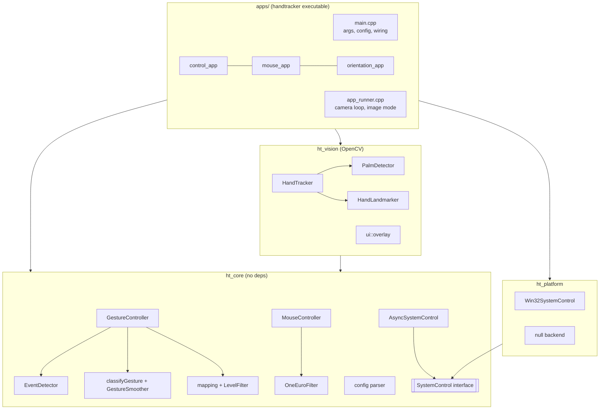

# Architecture

## Goals

1. **Keep the core testable.** Everything that decides *what* to do
   (classification, motion detection, modes, bindings, config) is plain C++17
   with no OpenCV or OS dependency, so it can be unit-tested with synthetic hands.
2. **Isolate the platform.** Everything that *does* something to the OS goes
   through one interface (`ht::SystemControl`), so adding Linux or macOS support
   doesn't touch gesture logic.
3. **Never block the camera loop.** Slow OS calls run on a worker thread.

## Layers

| Library | Depends on | Contents |
|---|---|---|
| `ht_core` | C++17 std, threads | landmarks, gestures, temporal events, actions, config, controller, filters, mappings, orientation, mouse controller, `SystemControl` interface, async + dry-run implementations |
| `ht_platform` | `ht_core`, Win32 | `createPlatformSystemControl()`, `platformInit()`, `makeWindowTopmost()` |
| `ht_vision` | `ht_core`, OpenCV | palm detector, landmark model, tracker, overlay |
| `handtracker` | all | CLI, camera loop, app modes |

## Per-frame data flow

1. **Capture**: `cv::VideoCapture` (DirectShow on Windows for fast startup),
   then flip horizontally if `camera.mirror`.
2. **Detect / track** (`vision::HandTracker::process`)
   - If a hand was found last frame, build a pseudo palm from its 7 palm
     landmarks and run only the landmark model (tracking).
   - Otherwise, or if more hands are allowed, run the palm detector:
     letterbox to 192×192, decode 2016 SSD anchors, sigmoid scores, NMS.
   - For each palm: crop 4× around it, rotate so wrist→middle-knuckle points
     up, crop 3× around the rotated palm keypoints, resize to 224×224, run the
     landmark model, then undo the crop/rotation to get frame-pixel landmarks.
3. **Convert** to `ht::HandLandmarks` (pixels + frame size + world points).
4. **Classify** (`classifyGesture`): five finger states → gesture table.
5. **Smooth** (`GestureSmoother`): majority vote over the last N frames.
6. **Control** (`GestureController::update`)
   - *Idle*: `EventDetector` emits at most one `Flip`, `Swipe*` or `Hold`
     event, which is matched against the bindings and executed.
   - *In a mode*: the hand pose drives a value through a mapping
     (`brightnessFromHand`, `volumeFromRoll`, …) and a `LevelFilter`
     (EMA + rate limit) before reaching `SystemControl`.
7. **Act**: `AsyncSystemControl` queues the command. Volume, brightness and
   cursor commands *coalesce*, so only the newest value is applied. The worker
   thread calls the platform backend.
8. **Draw**: skeleton, hold ring, mode level bar, toast, fps.

## Coordinate conventions

- Image landmarks are **pixels** in the processed (possibly mirrored) frame,
  x right, y down. `HandLandmarks::normalized()` divides by frame size.
- Scale-free thresholds use **palm size** = |wrist − middle MCP|.
- Motion thresholds (`swipe_distance`, `hold_max_motion`) are **fractions of
  the frame**.
- Roll is 0° with fingers up and positive when leaning towards image-right.
- World landmarks are metres, hand-centred, rotated back into camera axes.

## Gesture classification

A finger (index…pinky) is *extended* when

    |tip − wrist| > finger_extension_ratio × |pip − wrist|

A curled fingertip folds back towards the palm and ends up closer to the wrist
than its own middle joint, so this test works at any rotation and distance.

The thumb is *extended* when

    |thumb_tip − pinky_mcp| > thumb_extension_ratio × |thumb_ip − pinky_mcp|

A tucked thumb crosses the palm towards the pinky. This test doesn't care which
hand it is or whether the image is mirrored, which v1's x-comparison did.

The five booleans are matched against a table (see [GESTURES.md](GESTURES.md)).

## Temporal events

`EventDetector` keeps a sliding window of `(t, wrist_x, wrist_y, knuckle_side)`
samples no older than `swipe_window_ms`:

- **Flip**: the sign of `(index_mcp.x − pinky_mcp.x) / palm` (ignoring
  near-edge-on frames) differs between the earliest and latest samples.
- **Swipe**: the window spans at least half its length and the net
  displacement exceeds `swipe_distance`; the direction comes from the dominant axis.
- **Hold**: the same gesture has been seen for `hold_ms` with the wrist within
  `hold_max_motion` of where the hold started. It fires once until the
  gesture changes.

Any event clears the window and starts a `cooldown_ms` quiet period.

## Threading

| Thread | Work |
|---|---|
| main | capture, inference, classification, controller, drawing, `isProcessRunning` (cached 2 s) |
| `AsyncSystemControl` worker | all other `SystemControl` calls; owns the Win32 backend's COM objects and destroys the backend on exit |

The two share the backend through a mutex. The Win32 backend initialises COM
lazily on whichever thread calls it.

## Extending

- **New action**: add a `Kind` to `Action`, parse it in `parseAction`, execute
  it in `GestureController::execute`, and add a `SystemControl` method if it
  needs the OS.
- **New gesture**: add it to the `Gesture` enum and name table, add a finger
  pattern (or a custom predicate) in `classifyFingers`, and add a test.
- **New platform**: implement `SystemControl` plus the three free functions in
  `src/platform/<os>_system_control.cpp` and select it in `CMakeLists.txt`.
- **New mode**: add a `Mode`, a mapping function, and a case in
  `GestureController::updateMode`.

## Robot-arm front-end

A second front-end shares the engine. It adds two libraries:

| Library | Depends on | Contents |
|---|---|---|
| `ht_arm` | `ht_core` | `ArmBackend` interface, workspace mapping, `ArmController` (calibration, filtering, speed limit, claw / gripper rule) |
| `ht_arm_mujoco` | `ht_arm`, MuJoCo | `MujocoArm`: loads the SO-101 model, inverse kinematics, physics stepping |

The engine side gained `core/hand_space.*` (calibrated 3D hand position, and
since Dash 3 the claw measurements: fingertip spread and finger straightness).
The full data flow, coordinate frames, IK and simulator details are in
[DASH-2_ROBOT_ARM.md](DASH-2_ROBOT_ARM.md); proportional gripper control is in
[DASH-3_LIVE_CLAW.md](DASH-3_LIVE_CLAW.md).
