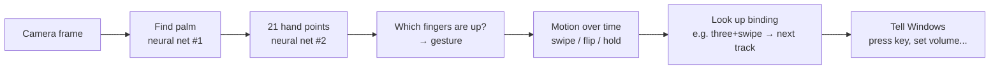

# Dash 1: rewriting Hand-Tracker in C++

> **What this doc is:** an explanation of *what was built and why*: the
> decisions, the tools, and how the code represents things. For *what's
> planned next*, see [FUTURE_FEATURES.md](FUTURE_FEATURES.md).

**Dash 1 in one sentence:** the three Python scripts of v1 were rewritten as
one C++ program, `handtracker`, with the same features, fewer bugs, tests, CI
and documentation.

---

## 1. The big picture

Every camera frame goes through the same pipeline:



Steps B–C are **vision** (the camera and neural nets), D–F are **logic** (pure
decisions), and G is **platform** (talking to Windows). The code is split along
those same lines (section 4).

---

## 2. C or C++? A short primer

You asked for C or C++. **C++ (the 2017 standard, "C++17")** was chosen because:

| | C | C++ |
|---|---|---|
| OpenCV (the vision library) | old C API was removed | native API |
| Organising code | functions + structs only | classes, namespaces, interfaces |
| Memory safety | manual `malloc`/`free` | automatic cleanup (RAII, see below) |
| Text, lists, maps | write your own | built into the standard library |

C++ is (almost) a superset of C, so anything C can do, this code can do too.

### Concepts you'll see everywhere in this repo

| Concept | Looks like | What it means |
|---|---|---|
| **Header / source** | `gesture.hpp` / `gesture.cpp` | `.hpp` *declares* what exists (like a table of contents); `.cpp` *defines* how it works. Other files `#include` the header. |
| **Namespace** | `ht::`, `ht::vision::` | A surname for names, so our `Vec3` never clashes with someone else's. `ht` = hand tracker. |
| **struct** | `struct Vec3 { float x, y, z; };` | A bundle of data, like a Python dataclass. |
| **class** | `class EventDetector { ... };` | Data + functions, with `private` parts hidden from outside code. |
| **enum class** | `enum class Gesture { Fist, Palm, ... };` | A fixed set of named values. Safer than strings: a typo won't compile. |
| **Reference** | `const HandLandmarks& hand` | "Use the caller's object, don't copy it". `const` = "and I promise not to change it". |
| **`std::optional<T>`** | `std::optional<HandLandmarks>` | "Maybe a value": used for "maybe a hand is visible". Like `None` in Python. |
| **`std::vector<T>`** | `std::vector<Binding>` | A growable list (Python `list`). |
| **`std::array<T, N>`** | `std::array<Vec3, 21>` | A fixed-size list: exactly 21 hand points. |
| **Interface** (virtual) | `class SystemControl { virtual bool setVolume(float) = 0; }` | A contract: "anything that can set volume". Real Windows code and fake test code both fulfil it. |
| **`std::unique_ptr<T>`** | `std::unique_ptr<HandTracker>` | Owns an object and deletes it automatically. |
| **RAII** | objects that clean up in their destructor | "Resource Acquisition Is Initialisation": when an object goes out of scope, it frees its memory, file, COM handle, etc. This is why there are no manual `free()` calls. |
| **`constexpr`** | `constexpr int kInputSize = 192;` | A constant known at compile time. Constants are named `kSomething`. |

### Compiling vs. running
Python runs your source directly. C++ is **compiled** first: a compiler turns
`.cpp` files into machine code and a *linker* joins them (plus libraries like
OpenCV) into `handtracker.exe`. Mistakes like typos or wrong types are caught at
compile time rather than halfway through a run.

---

## 3. The build system: CMake

C++ has no `pip install`. **CMake** is the standard tool that describes *what
to build*. `CMakeLists.txt` says things like "library `ht_core` is made of
these files" and "`handtracker.exe` uses `ht_core` and OpenCV". CMake then
generates instructions for whichever compiler you have:

| Platform | Compiler | Notes |
|---|---|---|
| Windows | MSVC (Visual Studio) | what you'd use |
| Linux | GCC | used in CI |
| macOS | Apple Clang | used in CI |

```powershell
cmake -S . -B build          # "configure": find compilers + libraries
cmake --build build          # compile everything
ctest --test-dir build       # run the tests
```

Two more settings worth knowing:
- `Release` vs `Debug`: optimised and fast vs. slower but easier to debug.
- `HT_WARNINGS_AS_ERRORS`: CI treats every compiler *warning* as an error, so
  sloppy code can't sneak in.

---

## 4. How the code is organised

| Library / program | Folder | Depends on | Job |
|---|---|---|---|
| `ht_core` | `src/core` | nothing (just C++) | gestures, motion events, modes, config, filters |
| `ht_platform` | `src/platform` | Windows APIs | volume, brightness, keys, mouse |
| `ht_vision` | `src/vision`, `src/ui` | OpenCV | neural nets, tracking, on-screen drawing |
| `handtracker` | `apps/` | all of the above | the program you run |
| tests | `tests/` | `ht_core` (+ vision) | 59+ automated checks |

**Why split it?** `ht_core` needs no camera, no OpenCV and no Windows, so it
can be tested with fake, computer-generated hands in milliseconds, on any OS.
Anything that touches the OS goes through **one interface**,
`SystemControl`, so adding Linux later means writing one new file.

---

## 5. How things are represented in code

| Real-world thing | In code | Notes |
|---|---|---|
| A 3D point | `Vec3 {x, y, z}` (floats) | `landmarks.hpp`. Has `+ - *`, `norm()`, `dot()`, `cross()`. |
| A detected hand | `HandLandmarks` | 21 `Vec3` points in **pixels** + frame size + left/right + confidence. Optional metric "world" points. |
| Which point is which | `enum class LandmarkId { Wrist, ThumbCmc, ..., PinkyTip }` | Same 0–20 numbering as MediaPipe. `hand[LandmarkId::IndexTip]`. |
| Fingers up/down | `FingerState {thumb, index, middle, ring, pinky}` (bools) | |
| A gesture | `enum class Gesture { None, Fist, Peace, MiddleFinger, One, Two, Three, Four, Palm }` | Found by matching `FingerState` against a small table. |
| A motion | `GestureEvent {type, gesture}` with `EventType { SwipeLeft, ..., Flip, Hold }` | |
| Time | `double` milliseconds | Passed in explicitly, so tests can fake time. |
| What a gesture does | `Binding {gesture, event, action, requireProcess}` | Loaded from the INI file. |
| An action | `Action {kind: Keys / EnterMode / Launch / Quit, ...}` | |
| Current mode | `enum class Mode { Idle, Brightness, Volume, Depth }` | A **state machine**: exactly one mode at a time (v1 had four independent booleans). |
| Settings | `AppConfig` struct, filled from `config/handtracker.ini` | Every field has a default. |

### Key algorithms, briefly
- **Finger up?** `distance(tip, wrist) > 1.1 × distance(middle joint, wrist)`.
  A curled finger folds back toward the wrist. This works at any hand angle
  (v1 compared heights, so it only worked upright).
- **Thumb out?** Measured against the pinky knuckle, so it works for left and
  right hands.
- **Smoothing:** majority vote over the last 5 frames (`GestureSmoother`).
- **Swipe:** wrist moved > 15% of the frame within 300 ms.
- **Hold:** same gesture, hand still, for 1 s; fires once.
- **Flip:** index and pinky knuckles swap sides.

---

## 6. External libraries and tools

### Used by the program

| Name | What it is | Why we need it |
|---|---|---|
| **OpenCV 4.7+** | The most widely used computer-vision library | Camera capture, image processing, drawing, and its **DNN module** runs neural networks |
| **MediaPipe hand models** (Google) | Two small neural networks: palm detector + 21-point hand landmarker | v1 used them through the MediaPipe Python package. We run the *same models* directly. |
| **OpenCV Model Zoo** | OpenCV's collection of pre-converted models | Provides MediaPipe's models as **ONNX** files (a standard neural-net file format), so we don't need MediaPipe itself. Downloaded by `scripts/download_models.*`. |
| **C++ standard library** | Comes with every compiler | lists, strings, threads, files, math |
| **Windows APIs** | Built into Windows | Replace v1's Python packages one-for-one: |
| ↳ Core Audio | | volume (was `pycaw`) |
| ↳ WMI + DDC/CI | | brightness: laptop screen + external monitors (was `screen_brightness_control`) |
| ↳ SendInput | | key presses, mouse (was `pyautogui`) |
| ↳ Toolhelp32 | | "is Spotify running?" (was `psutil`) |

### Used to build, test and publish

| Name | What it is | Used for |
|---|---|---|
| **CMake** | Build-system generator | See section 3 |
| **Git + GitHub** | Version control + hosting | Repo, branches, pull requests |
| **GitHub CLI (`gh`)** | Command-line tool for GitHub | Creating the repo and PRs from the terminal |
| **GitHub Actions** | Free CI servers | Builds and tests every PR on Windows, Linux and macOS |
| **Chocolatey / apt** | Package managers (Windows / Linux) | Install OpenCV on CI machines |
| **clang-format** | Code formatter | Consistent style (`.clang-format`) |
| Zig's bundled Clang compiler | A portable C++ compiler | *Only* used on your laptop to compile and test while you had no Visual Studio. Not part of the project. |
| Python | | *Only* used to inspect the ONNX files' input/output shapes. Not part of the project. |

---

## 7. Decisions made, and why

| Decision | Alternatives | Why this one |
|---|---|---|
| **C++17** rather than C | C, C++20 | See section 2. C++17 is supported by every compiler, including older Visual Studio. |
| Run MediaPipe models on **OpenCV DNN** | Build MediaPipe's C++ library | MediaPipe needs the Bazel build tool and is notoriously hard to build on Windows. OpenCV DNN runs the same models with one dependency. |
| **One executable with subcommands** (`handtracker mouse`) | three programs, like v1 | Shared camera loop and options, and one thing to install. |
| **INI config file** | JSON, YAML, hard-coded | Human-friendly and simple enough to parse ourselves (no extra library). |
| Gestures by **geometric rules** | train a classifier | Matches v1's approach and needs no training data. A learned classifier is on the roadmap. |
| **Time in milliseconds** | frame counts (v1) | Behaviour no longer depends on camera speed. |
| **Mirror the camera** by default | raw image | "Selfie view": moving your hand right moves it right on screen. Swipe directions are therefore in *your* frame of reference. |
| Brightness from **hand height** | finger length (v1) | v1's value changed when you moved closer to the camera. |
| **Pinch to click** in mouse mode | open palm (v1) | A misread palm used to drop whatever you were dragging. |
| OS calls on a **background thread** | inline (v1) | Setting brightness takes up to 150 ms and froze the video. |
| **Our own tiny test framework** | GoogleTest, Catch2 | No downloads needed to build tests. Easy to swap later. |
| **MIT license** | GPL, Apache, none | Most common permissive license. Easy to change. |
| **Public repo** `Jzhen7/Hand-Tracker-CPP` | private | You confirmed this. |
| **Feature branches + PRs** with Conventional Commit messages | commit straight to `main` | Reviewable history, and CI checks every change. |
| No "Co-Authored-By: Claude" in commits | | You asked for everything under your account. |

---

## 8. How it's tested

| Test type | What it checks | Where |
|---|---|---|
| Unit tests with **synthetic hands** | every gesture at any angle/size/hand, swipes, holds, flips, modes, config parsing, filters | `tests/`, using `hand_builder.hpp` to generate fake hands |
| **End-to-end photo test** | Real photos of a ✌️ and a 👍 go through the whole pipeline and must come out as `peace` and `one` | CI on Windows + Linux |
| **CI** on 3 operating systems | Everything compiles with zero warnings and all tests pass | `.github/workflows/ci.yml` |

---

## 9. Problems hit along the way

| Problem | Cause | Fix |
|---|---|---|
| Linux CI couldn't load the models | Ubuntu's packaged OpenCV is 4.6, which can't read the models' `Clip` layers | Build OpenCV 4.10 in CI (cached); require 4.7+ |
| macOS CI job cancelled | GitHub retired the `macos-14` machine | Use `macos-latest` |
| CI didn't start on the first PR | GitHub quirk with brand-new repos | Merged the verified core PR first; CI worked from then on |
| One test failed | The *test* teleported the hand, which correctly counted as a swipe | Fixed the test |
| `gh` "not recognised" | PATH not refreshed after install | Ran it by full path |

---

## Glossary

| Term | Meaning |
|---|---|
| **Landmark** | One of the 21 tracked points on the hand (joints and fingertips) |
| **ONNX** | Standard file format for neural networks |
| **DNN** | Deep neural network; OpenCV's module for running them |
| **CI** | Continuous integration: robots that build and test every change |
| **PR** | Pull request: a proposed change, reviewed and merged on GitHub |
| **Interface** | A class that only declares functions, so different implementations can be swapped |
| **State machine** | Code that is in exactly one "state" (mode) at a time, with defined transitions |
| **One Euro filter** | A smoothing filter that removes jitter without adding lag to fast moves |
