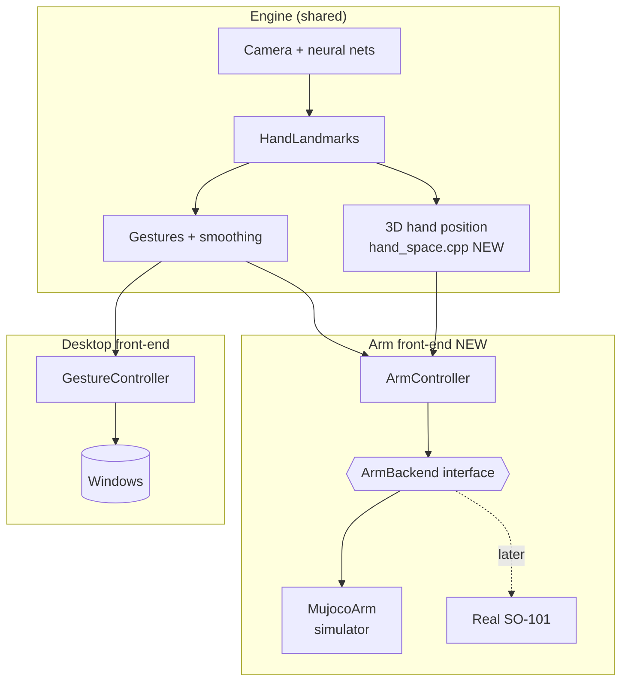

# Dash 2: controlling a (simulated) robot arm

> **What this doc is:** how the robot-arm front-end works, and the decisions
> made building it. Read [Dash 1](DASH-1_CPP_REVAMP.md) first for C++ basics.
> Planned arm features are in [FUTURE_FEATURES.md](FUTURE_FEATURES.md).

> **Update (Dash 3):** the gripper is now proportional and closes with a
> straight-fingered "claw" instead of a fist. See
> [DASH-3_LIVE_CLAW.md](DASH-3_LIVE_CLAW.md). The fist rule below is still
> available as `gripper_mode = binary`.

**Status:** milestone 1 (MVP) is complete: implemented, tested in simulation,
and run live with a webcam on Windows 11 (MSVC 2022, OpenCV 4.10, about 28 fps).

**The rules of the MVP:**

| Your hand | The arm |
|---|---|
| moves left / right / up / down / toward / away from the camera | the gripper moves the same way, anywhere inside its reachable box |
| makes a **fist** | gripper **closes** |
| any other shape | gripper **opens** |
| leaves the camera view | arm **holds** its position and grip |

```powershell
scripts\download_arm.ps1            # once: MuJoCo + the arm model
cmake -S . -B build ... ; cmake --build build --config Release
build\Release\handtracker.exe arm   # hold an open palm still for 2 s to calibrate
```

Keys: `c` recalibrate · `a`/`d` rotate the 3D view · `q` quit.

---

## 1. Where the arm fits in the project

The arm is a **second front-end** next to the desktop one, sharing the same
hand-tracking engine. It isn't a mode inside the desktop app.



| New piece | File(s) | Needs MuJoCo? |
|---|---|---|
| 3D hand position, calibration, fist rule | `core/hand_space.*` | no (engine; any front-end can use it) |
| `[arm]` settings | `core/config.*`, `config/arm.ini` | no |
| `ArmBackend` interface | `arm/arm_backend.hpp` | no |
| Workspace mapping | `arm/workspace.*` | no |
| `ArmController` (the brain) | `arm/arm_controller.*` | no |
| `MujocoArm` (simulated arm + IK) | `arm/mujoco_arm.*` | **yes** |
| `handtracker arm` app + 3D viewer | `apps/arm_app.cpp`, `apps/arm_view.*` | yes |

The `desktop` subcommand was added as the new name for `control` (both work),
so the two front-ends read as equals: `handtracker desktop` and
`handtracker arm`.

**Why an `ArmBackend` interface?** Everything above it talks to "an arm":
set target, set gripper, advance time, read state. Today that's the simulator.
A real SO-101 later is one new class, with no changes to the controller,
mapping or tests.

---

## 2. Data flow, frame by frame

| # | Step | Output | Code |
|---|---|---|---|
| 1 | Camera + neural nets | 21 hand points (pixels) | engine (Dash 1) |
| 2 | Gesture + majority-vote smoothing | e.g. `Fist` | `GestureSmoother` |
| 3 | 3D hand position vs. calibration | hand cube, about −1…+1 per axis | `handPosition()` |
| 4 | Map cube onto arm workspace | target in metres | `handToWorkspace()` |
| 5 | Smooth + speed-limit the target | safe target | `ArmController::track()` |
| 6 | Fist → close, else open | gripper command | `gripClosed()` |
| 7 | Inverse kinematics | 5 joint angles | `MujocoArm::solveIk()` |
| 8 | Send angles to simulated servos, run physics for the real time elapsed | new arm pose | `MujocoArm::advance()` |
| 9 | Draw camera + 3D arm side by side | window | `ArmView::render()` |

---

## 3. Three coordinate systems

Most of the arm work is converting between these:

| Space | Units | Axes | Where |
|---|---|---|---|
| **Image** | pixels | x right, y **down** (screen convention) | neural-net output |
| **Hand cube** | none, about −1…+1 | x = your right, y = up, z = toward camera | after calibration |
| **Arm base frame** | metres | **X forward, Y left, Z up** (robotics convention) | simulator, targets |

The mapping assumes you stand **behind** the arm, facing the same way it does,
which is how the 3D view shows it by default:

| Hand | Arm |
|---|---|
| right (+x) | its right (**−Y**) |
| up (+y) | up (+Z) |
| toward camera (+z) | forward (+X) |

Angles are in **radians** (MuJoCo's convention): π rad = 180°.

---

## 4. Depth from a single webcam

A webcam has no depth sensor, so **depth comes from how big your palm looks**:
closer means bigger.

- **What's measured:** wrist → middle-finger knuckle. This length stays the
  same when you make a fist. Measuring to the fingertips would make the arm
  lurch backwards every time you grabbed.
- **Calibration:** hold an open palm still for 2 s. Its position becomes the
  centre of the workspace and its size becomes "middle depth".
- **Formula:** `depth = ln(current size / calibrated size) / 0.35`. A log is
  used because size is inversely proportional to distance, so "twice as big"
  and "half as big" end up equally far from the centre.
- **Limitation:** tilting your hand also changes its apparent size, so depth is
  the noisiest axis. Keep your palm facing the camera. A second camera would fix
  this (it's in the future features).

---

## 5. The simulator: MuJoCo

**MuJoCo** ("Multi-Joint dynamics with Contact") is a free physics engine from
Google DeepMind, widely used in robotics research. It's a C library, so it
plugs straight into our C++.

| Concept | Meaning |
|---|---|
| **MJCF** (XML file) | Describes the robot: links, joints, motors, meshes. We load `models/so101/scene.xml`. |
| `mjModel` | The loaded robot description. Doesn't change while running. |
| `mjData` | The changing state: joint angles, velocities, motor commands. |
| `mj_step()` | Advances physics by one **timestep** (5 ms for this model). |
| **Position actuator** | A simulated servo: write a desired angle into `ctrl` and it drives the joint there, like the real arm's STS3215 servos. |
| **Site** | A named reference point. `gripperframe` sits between the fingertips; it's what we steer. |

**Real-time sync:** each camera frame, `advance(dt)` runs as many 5 ms
physics steps as real time has passed (about 7 steps at 30 fps), capped at
0.1 s so a stall can't make the arm lurch.

**The arm: SO-101.** A ~$150–250 open-source 6-servo arm (5 joints + gripper)
by TheRobotStudio, popular with the Hugging Face LeRobot community. Its MuJoCo
model comes from **MuJoCo Menagerie**, DeepMind's library of robot models.

Joints, base to tip: `shoulder_pan`, `shoulder_lift`, `elbow_flex`,
`wrist_flex`, `wrist_roll`, `gripper`.

---

## 6. Inverse kinematics (IK): turning "go here" into joint angles

**Forward kinematics** is easy: given joint angles, where's the fingertip?
MuJoCo computes that. **Inverse kinematics** is the reverse: given a target
point, which joint angles reach it? There's no simple formula, so we
**iterate**:

1. `error` = target − fingertip (3 numbers).
2. Ask MuJoCo for the **Jacobian** `J`: how much the fingertip moves per tiny
   turn of each joint (a 3 × 4 table).
3. Compute the joint change that best reduces the error:
   `Δq = Jᵀ (J Jᵀ + λ²I)⁻¹ · error`. This is **damped least squares**; the
   damping `λ` stops wild jumps when the arm is fully stretched.
4. Clamp to joint limits and repeat (10 times per frame).

It runs on a **scratch copy** of the state, so the real arm only moves through
its servos.

### The null-space fix (a bug found by testing)
Reaching a 3D point only needs 3 joints, but we use 4, so there's one "spare"
motion that doesn't move the fingertip. Without guidance, the arm slowly drifted
into a pose pressed against a joint limit and got stuck:

| IK version | Worst miss over 49 random targets |
|---|---|
| plain damped least squares | **313 mm** |
| + gentle pull toward a "ready" pose using the spare motion (gain 0.05) | **4 mm** |

The fix is the `(I − J⁺J)·bias` term in `solveIk()`. A regression test now
drives the arm through 40 random targets.

`wrist_roll` is left out of IK because it spins the gripper without moving the
fingertip. It'll be used when orientation control arrives.

---

## 7. The workspace box

The hand cube is mapped onto a box in front of the arm. The box was chosen by
running IK on a 5 × 5 × 5 grid of points in a Python prototype:

| Candidate box (m) | Unreachable points |
|---|---|
| X 0.15–0.30 · Y ±0.15 · Z 0.05–0.25 | 2 / 125 (too close to the base) |
| **X 0.17–0.31 · Y ±0.13 · Z 0.06–0.24** | **0 / 125, worst 0.1 mm** ✅ |

So the box is 14 × 26 × 18 cm. Targets outside it are **clamped** to its
surface, so the arm never strains toward an impossible point. The box is
configurable in `arm.ini` (`workspace_min`, `workspace_max`).

---

## 8. Smoothness and safety

| Mechanism | Why | Setting |
|---|---|---|
| **One Euro filter** on the target | Removes landmark jitter but stays responsive to fast moves | `min_cutoff`, `beta` |
| **Speed limit** | A tracking glitch can't fling the arm across the workspace | `max_speed` (0.6 m/s) |
| **Clamping** to the workspace | No unreachable targets | `workspace_*` |
| **Hold on hand loss** | The arm doesn't drop or wander when you step away | always on |
| **Gesture smoothing** | One misread frame won't flick the gripper | `smoothing_frames` |
| Ambiguous gesture keeps the gripper as-is | Transitional hand shapes don't count as "open" | always on |

---

## 9. The 3D view

MuJoCo has its own 3D renderer, but it needs an OpenGL window library (GLFW)
and a GPU context. For the MVP we draw the arm with **OpenCV** instead: MuJoCo
gives us the 3D position of every joint, and we project them to 2D like a
camera (`screen = focal × (x, y) / depth`).

The view shows:
- the arm
- floor shadows (to help judge depth)
- the workspace box
- the target (yellow)
- the gripper (green = open, red = closed)
- target and reach error in cm/mm

A full MuJoCo 3D view is listed as a future feature.

---

## 10. Testing

| Test | What it proves | Needs |
|---|---|---|
| Hand-space tests | right/up/closer map correctly; a fist doesn't change depth | nothing |
| Calibrator tests | open palm held still calibrates; moving or other gestures restart it | nothing |
| Workspace tests | centre, axis directions, clamping | nothing |
| `ArmController` vs. a **fake arm** | calibrate → follow; fist closes; hand loss holds; speed limit works | nothing |
| Config tests | `[arm]` parses; shipped `.ini` files have zero warnings | nothing |
| **Headless simulation** | real MuJoCo arm reaches all 8 corners + centre (< 1 cm), survives 40 random targets, gripper opens/closes | MuJoCo + model |

"Headless" means no window, so it runs on CI servers. CI downloads MuJoCo and
the model on Linux and Windows and runs all of these.

---

## 11. New external tools

| Name | Version | What / why | License |
|---|---|---|---|
| **MuJoCo** | 3.17.0 (pinned) | Physics simulator. Version 4.0 came out days before this was built, so the established 3.x line was pinned. | Apache 2.0 |
| **MuJoCo Menagerie: SO-101** | commit `3abca2e` (pinned) | The arm's model and 3D meshes (18 MB, downloaded, not committed) | Apache 2.0 |
| `scripts/download_arm.ps1` / `.sh` | — | Fetch both into `third_party/mujoco` and `models/so101` | — |
| Python + `mujoco` package | — | **Prototyping only:** checked reachability, IK behaviour and gripper direction before writing the C++. Not part of the project. | — |

CMake builds the arm **automatically if MuJoCo is present** and skips it
otherwise, so the desktop front-end never requires MuJoCo.

---

## 12. Decisions made on your behalf

These can all be changed. Most are one line in `config/arm.ini`.

| Decision | Chosen | Why | Change it by |
|---|---|---|---|
| Arm model | **SO-101** (not the older SO-ARM100) | You chose the cheap arm; SO-101 is the version currently sold | another Menagerie model + edit names in `mujoco_arm.cpp` |
| Simulator | MuJoCo 3.17.0 | native C API, headless, ready-made SO-101 model | — |
| Gripper angles | open = 1.2 rad, closed = 0.0 rad | 0 is where the jaws meet; 1.75 (fully open) seemed excessive | `gripper_open` / `gripper_closed` |
| Workspace box | 14 × 26 × 18 cm (section 7) | largest box tested 100% reachable | `workspace_min/max` |
| Viewpoint/mapping | you "stand behind" the arm | your left/right then match the arm's on screen | `handToWorkspace()` |
| Calibration | open palm, still, 2 s | same gesture as "neutral"; long enough to be deliberate | `calibration_ms` |
| Depth sensitivity | ±35% palm-size change = full depth range | comfortable reach without leaning | `depth_range` |
| Speed limit | 0.6 m/s | quick but not violent | `max_speed` |
| Hand lost | hold position + grip | safest default for a real arm later | code |
| Orientation | ignored in MVP | as agreed; milestone 2 | — |
| Viewer | OpenCV drawing, not MuJoCo's renderer | no extra graphics dependency; works in CI | future feature |
| `desktop` subcommand | added as alias for `control` | makes the two front-ends equals; nothing breaks | — |
| Doc names | `DASH-1_…`, `DASH-2_…` in `docs/` | `docs/` already existed | rename freely |
| PRs | opened, **not merged** | so you can review first | merge on GitHub |

---

## 13. Known limitations (MVP)

- Depth is estimated, so it's noisier than left/right/up/down (section 4).
- The gripper's angle doesn't follow your wrist yet.
- Absolute mapping: your comfortable hand range sets the reachable range.
  "Clutch" mode (move, release, reposition) is planned.
- The simulated gripper has no objects to pick up yet (a pick-and-place scene
  is planned).
- Live-camera testing so far is a start-up check: camera, model and
  calibration work at about 28 fps (29 ms inference) on a laptop webcam.
  How it *feels* to steer (sensitivity, depth range, speed limit) still needs
  hands-on tuning in `config/arm.ini`.
